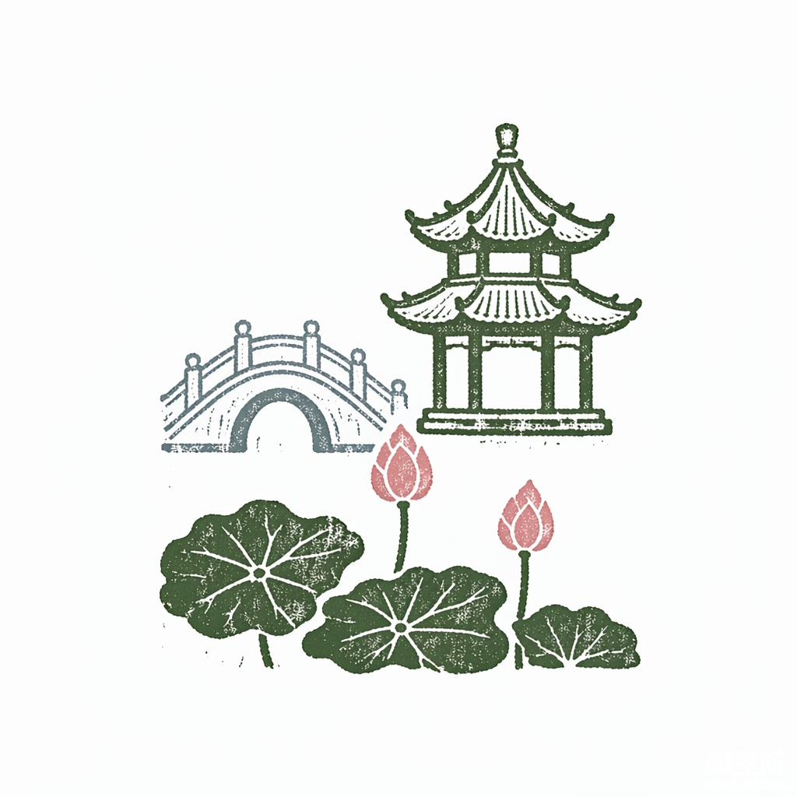
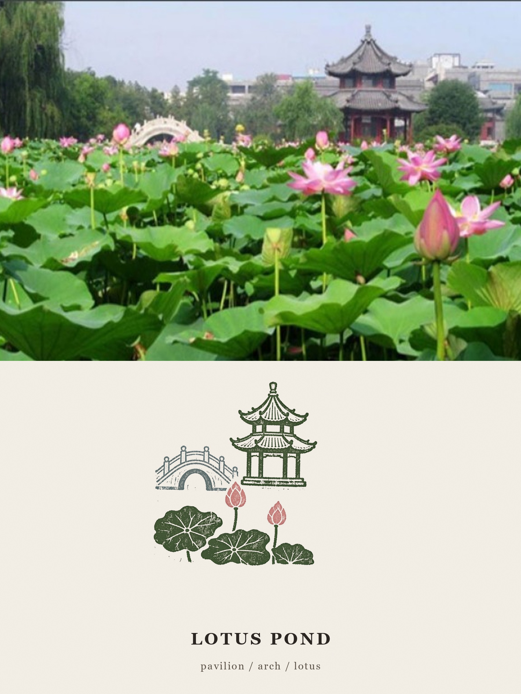
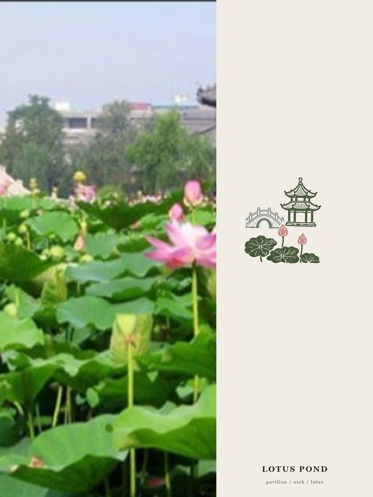

# 照片变印章 · photo-memory-stamp

> 上传一张照片，自动刻成一枚复古套色印章，合成一张「摄影记忆印章」档案卡。
> **照片负责记录现实，印章负责保存记忆。**

一个 WorkBuddy 技能（Skill）。说一句「把这张照片做成印章」并附图，自动完成：分析主体 → 提炼记忆锚点 → 刻章 → 排版成卡。

---

## 效果

原图（什么都不会被改）：


刻出来的印章（三色套印、手工刻痕）：



合成成片（左/上为原封未动的照片，右/下为米白档案纸 + 印章 + 标题 + 3 个关键词）：



竖版照片会自动换成左右版式：



---

## 为什么不是滤镜

滤镜只「调色」，从不「提炼」。照片里真正的记忆点——那座桥的拱洞、那盏灯笼的光、那块招牌的字——滤镜一个都留不住。

这枚印章走的是另一条路：**主体提炼 → 结构简化 → 色彩压缩 → 印刷语言转译**。所以它是为这张照片**单独刻**的，不是把照片缩小加滤镜。

判断标准只有一条：**把印章单独拿出来，还能认出这是哪儿。** 认不出，就只是滤镜。

---

## 安装（3 步）

1. 把整个 `photo-memory-stamp` 文件夹放进 WorkBuddy 的技能目录：

   | 系统 | 路径 |
   |---|---|
   | Windows | `C:\Users\<你的用户名>\.workbuddy\skills\` |
   | macOS / Linux | `~/.workbuddy/skills/` |

   放好后应该是 `~/.workbuddy/skills/photo-memory-stamp/SKILL.md`。

2. 重启 WorkBuddy（或新开一个会话）。

3. 发一张照片，说「**把这张照片做成印章**」。

说这些词也能触发：照片变印章、记忆印章、摄影印章、印章卡、档案卡、photo to stamp。

## 依赖

| 依赖 | 说明 |
|---|---|
| Pillow | 图像处理。WorkBuddy 托管 Python 环境一般已自带 |
| ImageGen | WorkBuddy 内置出图能力，**单张约消耗 5-10 credits** |
| Georgia 字体 | Windows / macOS 系统自带；缺失时自动回退 Times |

技能不含任何密钥，所有出图走 WorkBuddy 自带的 ImageGen，不额外配置 API Key。

---

## 用法

### 对话里用

```
把这张照片做成印章
（附图）
```

技能会自动跑完 5 步，交付一张 3:4 档案卡，并把用到的完整印章提示词原文发给你（方便复用）。

### 命令行用

```bash
# Windows 的 Python 解释器路径按自己的环境改
PY="$HOME/.workbuddy/binaries/python/envs/default/Scripts/python.exe"
SK="$HOME/.workbuddy/skills/photo-memory-stamp/scripts/stampkit.py"

# 1. 预处理：统一 EXIF 方向 / sRGB / 长边≤2048
"$PY" "$SK" prepare photo.jpg --info

# 2. 取色：给出 1/2/3 色套印建议
"$PY" "$SK" palette photo_clean.jpg

# 3. 合成（印章图由 ImageGen 出）
"$PY" "$SK" compose photo_clean.jpg --stamp stamp.png \
    --title "LOTUS POND" --keywords "pavilion / arch / lotus" \
    --layout auto --share 0.54

# 4. 多版拼对比图
"$PY" "$SK" sheet out/ --out out/compare.jpg
```

### `compose` 常用参数

| 参数 | 默认 | 说明 |
|---|---|---|
| `--layout` | `auto` | `auto` 横图走上/下版、竖图走左/右版；也可强制 `top` / `left` |
| `--ratio` | `3:4` | 画幅，可选 `3:4` / `4:5` / `1:1` |
| `--share` | `0.54` | 照片占比 0.45–0.68 |
| `--title` | 空 | 2-4 个英文单词，自动转大写 |
| `--keywords` | 空 | 恰好 3 个，格式 `a / b / c` |
| `--paper` | `F4EFE7` | 档案纸色 |
| `--stamp-size` | `0.78` | 印章大小（相对档案区） |
| `--rotate` | `-1.2` | 微旋角度，手工压印感来源，`0` 为绝对工整 |
| `--noise` | `5` | 纸张颗粒，`0` 为纯净 |

---

## 三个已经替你踩过的坑

| 坑 | 现象 | 对策（技能里已内置） |
|---|---|---|
| 「方形」是个陷阱 | 提示词写"方形外廓"，模型立刻画一圈**边框**，印章变画框 | 外形一律不写"方形"，改成"沿主体外缘自然结束，不要任何外框线" |
| 浅色专色会消失 | 石头灰这类高明度色印在米白纸上几乎看不见 | 取色后把明度压到 55–70% 再用 |
| 中文"印章"的先验 | 极容易画出**红色圆形公章**（五角星 + 弧形汉字） | 禁止清单第一句就打死它 |

更多调参和失败修法见 `references/diagnose.md` 的「失败修法表」与「九条自检」。

---

## 目录结构

```
photo-memory-stamp/
├── SKILL.md                       # 工作流：预处理 → 分析 → 刻章 → 合成 → 自检
├── references/
│   ├── prompt-master.md           # 提示词母版（槽位表 / 印章本体 / 全版兜底 / 示例 / 原理）
│   ├── diagnose.md                # 类型判定 / 锚点四法 / 查表 / 失败修法 / 自检
│   ├── examples.md                # 荷塘案例四版迭代实录 + 单变量调参
│   └── article-original.md        # 原文条款存档
├── scripts/
│   └── stampkit.py                # prepare / palette / compose / sheet
└── docs/                          # 示例图（不参与运行）
```

## 它是怎么工作的（一句话版）

一次成图会让模型重绘你的照片、把英文标题拼错。所以这里把任务拆开：**AI 只负责刻章（它擅长），版式与文字交给程序（它不会错）**。照片逐像素保真，文字 100% 正确，叠印走正片叠底，等效于油墨压纸。

---

## 出处

提示词母版基于微信公众号「鲟觅大好河山」文章《这个提示词把你的照片变成印章》（作者：六拾七，2026-10-09）改造，工程实现与调参经验为后加。

## 许可

个人使用与教学使用免费。转载、二次分发请保留本 README 与出处说明。
